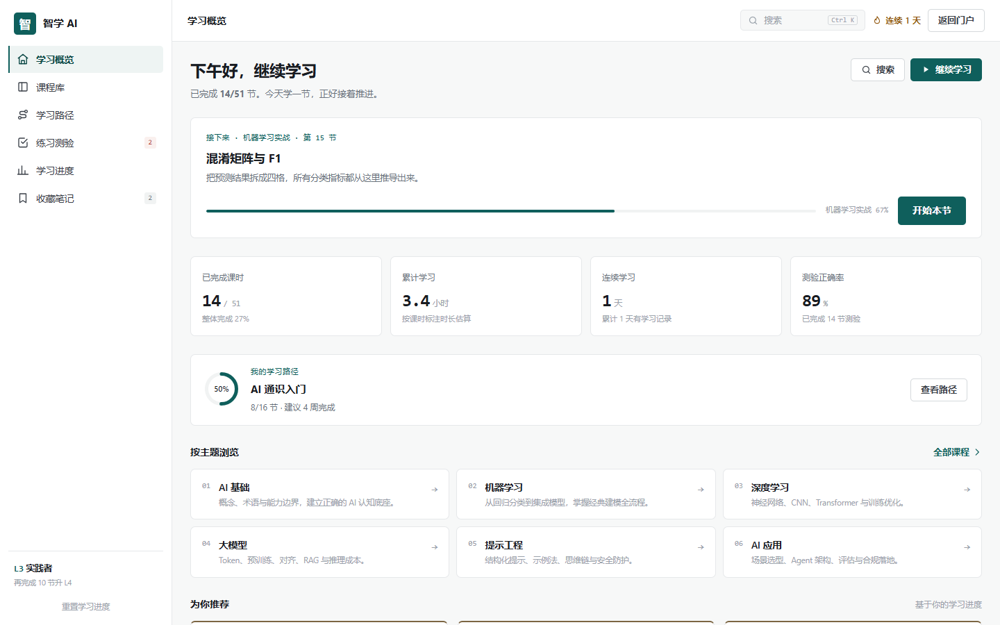
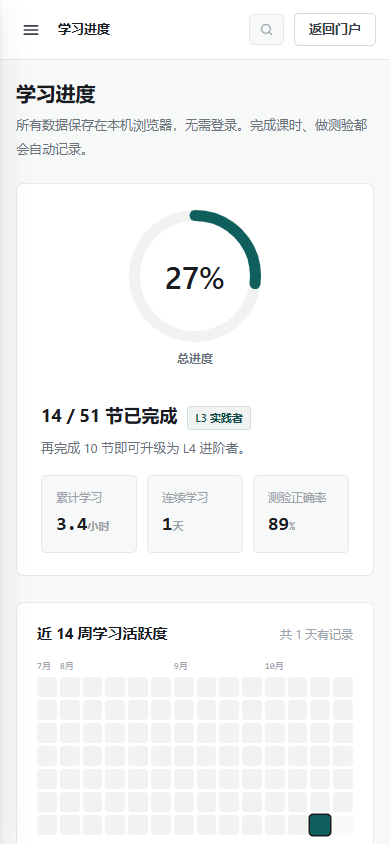

# 智学 AI · AI LEARNING HUB

一套可直接运行的人工智能学习平台：6 门系统课程、51 节课、102 道随堂测验、4 条学习路径，以及 6 题能力测评。无需注册，学习进度保存在浏览器本地。

**在线预览：** <https://shangtianqiang.github.io/ai-learning-hub/>

## 在线入口

| 入口 | 地址 |
| --- | --- |
| 门户首页 | <https://shangtianqiang.github.io/ai-learning-hub/> |
| 学习工作台 | <https://shangtianqiang.github.io/ai-learning-hub/app.html> |
| 优化测试报告 | <https://shangtianqiang.github.io/ai-learning-hub/%E4%BC%98%E5%8C%96%E6%B5%8B%E8%AF%95%E6%8A%A5%E5%91%9A.html> |

## 功能概览

- **课程体系**：AI 基础、机器学习、深度学习、大模型、提示工程、AI 应用，共 6 门课程、51 节课。
- **随堂测验**：102 道题即时判分并给出解析，答错自动进入错题本。
- **学习路径**：4 条路线，覆盖通识入门、机器学习、大模型应用与 AI 产品落地；6 题测评按基础与目标推荐路径。
- **练习与考试**：按主题随机组卷、错题重练、课程结课测验。
- **进度追踪**：完成率、学习时长、连续天数、分类掌握度、能力雷达、26 周活跃度热力图与结业证书。
- **收藏与笔记**：课时收藏、笔记自动保存，全部数据存储在本机 `localStorage`。
- **全站搜索**：支持课程与课时检索，快捷键 `Ctrl K` / `⌘ K`。
- **响应式布局**：适配桌面、平板、手机与 320px 窄屏，无后端依赖。

## 页面截图

| 桌面首页 | 移动端学习进度 |
| --- | --- |
|  |  |

更多截图见 [`assets/report/`](assets/report/)。

## 项目结构

```text
.
├── index.html              # 门户首页
├── app.html                # 学习工作台
├── assets/
│   ├── css/
│   │   ├── base.css        # 设计变量与通用组件
│   │   ├── landing.css     # 门户样式
│   │   └── app.css         # 工作台样式
│   ├── js/
│   │   ├── data.js         # 课程 / 课时 / 题库 / 路径 / 测评
│   │   ├── store.js        # localStorage 状态与进度
│   │   ├── engine.js       # 检索 / 推荐 / 组卷 / 统计
│   │   └── app.js          # 路由 / 页面渲染 / 交互
│   └── report/             # 测试报告截图
├── 优化测试报告.html        # 界面优化与端到端测试报告
├── .nojekyll               # GitHub Pages 静态直出
└── README.md
```

## 本地运行

项目是纯静态页面，不需要安装依赖或构建。任选一种方式启动本地服务：

```bash
python -m http.server 8765
```

然后打开：

```text
http://127.0.0.1:8765/
```

也可以直接双击 `index.html`，但建议通过本地 HTTP 服务预览，以保证资源路径与线上一致。

## 测试与报告

- 端到端功能测试：**100 / 100** 通过
- 本地预览与窗口缩放复验：**53 / 53** 通过
- GitHub Pages 线上复验：**26 / 26** 通过
- 控制台 / 页面错误：**0**
- 内部链接：**76 / 76** 有效
- 数据完整性：6 门课程 / 51 节课 / 102 道题，**0 issues**

完整优化点、问题修复记录与界面证据见：[优化测试报告](优化测试报告.html)。

## 技术说明

- 原生 HTML / CSS / JavaScript，无框架、无第三方依赖、无构建步骤。
- 课程、课时、题库与路径数据集中在 `assets/js/data.js`。
- 学习记录、笔记、收藏、错题与测评结果保存在浏览器 `localStorage`，清理站点数据后会被重置。
- 页面通过 hash 路由组织：`#/home`、`#/courses`、`#/lesson/...`、`#/practice`、`#/progress` 等。

## 部署

- GitHub Pages 源：`main` 分支 / 仓库根目录
- 站点地址：<https://shangtianqiang.github.io/ai-learning-hub/>
- 仓库地址：<https://github.com/shangtianqiang/ai-learning-hub>

如果从仓库 fork 或重新部署，只需在 GitHub Pages 中选择 `main` 分支与 `/` 根目录即可。
